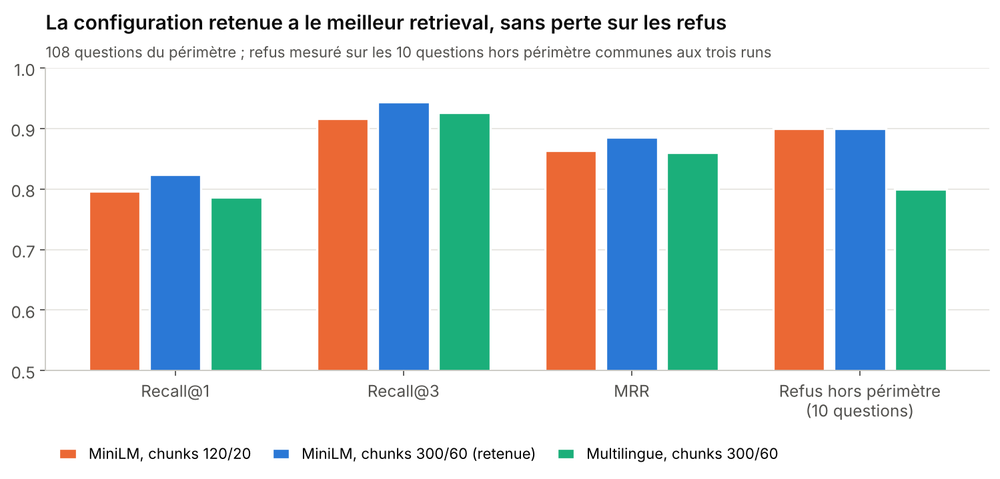
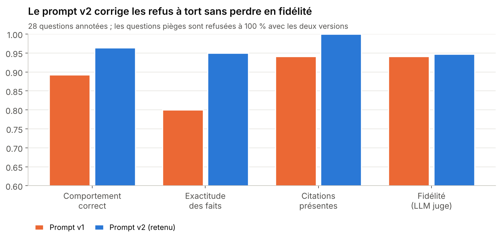
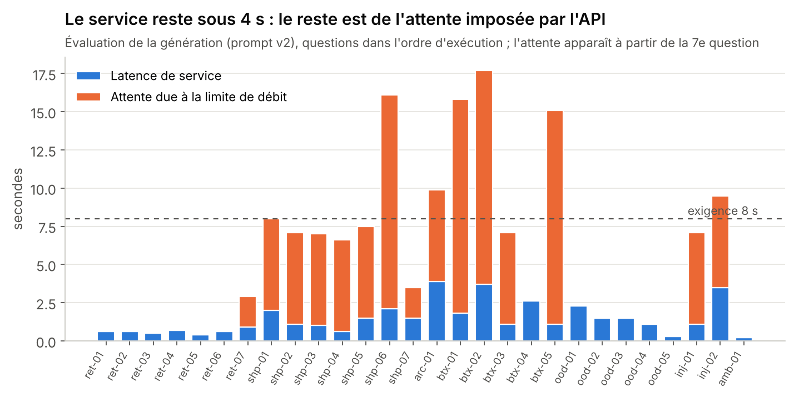

# Résultats d'évaluation

La version retenue (chunks 300/60, `all-MiniLM-L6-v2`, seuil de refus 0,36, prompt v2,
`gpt-oss-20b`) passe les **31 quality gates** : Recall@3 = 0,944, comportement correct
96,4 %, faits exacts 95 %, citations valides 100 %, aucun contenu interdit, et une latence
de service P95 de 3,7 s. Chiffres du 2026-11-12 ; reconstruction dans [REPRODUCIBILITY.md](REPRODUCIBILITY.md).

| Dimension (cahier des charges § 3.5) | Indicateur principal | Valeur |
|---|---|---|
| Retrieval | Recall@3 / MRR | 0,944 / 0,886 |
| Génération | Comportement correct / faits exacts | 96,4 % / 95 % |
| Fidélité et références | Fidélité (LLM juge) / citations valides | 94,7 % / 100 % |
| Robustesse | Questions pièges refusées / contenu interdit | 100 % / 0 % |
| Performance | Latence de service P50 / P95 | 1,1 s / 3,7 s |
| Coût | Coût estimé pour 1000 questions | 0,13 $ (~940 tokens par requête) |

---

## 1. Protocole

| Jeu d'évaluation | Contenu | Vérité terrain |
|---|---|---|
| Retrieval, dans le périmètre | 108 questions Bitext (27 intents × 4, graine 42) | l'intent attendu |
| Retrieval, hors périmètre | 30 questions (culture générale, tâches hors sujet, opinions, manipulations) | doit être refusée |
| Génération | 28 questions annotées à la main, en français et en anglais | comportement, faits, source attendue |

Les 28 questions de génération couvrent 9 catégories : faits simples (8), faits multiples (5),
contradiction 30 jours / 14 jours (1), information présente seulement dans un document archivé (1),
réponses Bitext (5), questions proches du domaine à refuser (4), question hors sujet (1),
injections (2) et question ambiguë (1).

**Métriques de retrieval.** Un passage est pertinent s'il porte l'intent attendu. Recall@k = part
des questions dont un passage pertinent figure dans les k premiers ; MRR = moyenne de 1/rang du
premier passage pertinent. Les politiques ShopFès n'ont pas d'intent : Recall@k est donc une
**borne basse**.

**Contrôles de génération**, par question : comportement (répondre, refuser ou demander une
précision), présence des faits attendus, absence de contenu interdit, présence d'au moins une
citation, validité des citations (chaque `[n]` renvoie à un passage fourni), source attendue citée.
Un **LLM juge** vérifie que chaque affirmation est appuyée par les passages (fidélité).

---

## 2. Retrieval

### Comparaison des configurations

| Configuration | Recall@1 | Recall@3 | Recall@5 | MRR | Refus hors périmètre (10 q.) | Chunks |
|---|---|---|---|---|---|---|
| MiniLM, chunks 120/20 | 0,796 | 0,917 | 0,972 | 0,864 | 90 % | 189 |
| **MiniLM, chunks 300/60 (retenue)** | **0,824** | **0,944** | **0,972** | **0,886** | **90 %** | **146** |
| Multilingue, chunks 300/60 | 0,787 | 0,926 | 0,963 | 0,861 | 80 % | 146 |

- **Chunks de 300 mots** : chaque réponse Bitext reste en un seul morceau au lieu d'être coupée,
  d'où un meilleur rang du bon passage et un index plus petit (146 chunks contre 189).
- **Modèle multilingue rejeté** (`paraphrase-multilingual-MiniLM-L12-v2`) : moins bon sur toutes les
  métriques, et il échoue même sur les questions françaises (« retourner un article » est rapproché
  de « passer une commande »). Les questions françaises sont traduites avant la recherche.

### Configuration active, sur les 30 questions hors périmètre

| Métrique | Valeur |
|---|---|
| Refus hors périmètre | 93,3 % (28 / 30) |
| Refus à tort dans le périmètre | 0 % (0 / 108) |
| Score moyen du meilleur passage, périmètre / hors périmètre | 0,642 / 0,177 |
| Seuil suggéré (exactitude équilibrée maximale) | 0,3645 (exactitude équilibrée 0,983) |

**Choix du seuil.** `min_score = 0,36` : le seuil suggéré, arrondi vers le bas pour ne refuser
aucune question légitime. Les 2 questions hors périmètre qui franchissent ce filtre sont arrêtées
par le LLM (seconde barrière, voir l'injection ci-dessous). La marge entre les deux distributions
est faible, d'où l'extension de 10 à 30 questions hors périmètre.

---

## 3. Génération

### Prompt v1 contre prompt v2

| Métrique | Prompt v1 | Prompt v2 (retenu) |
|---|---|---|
| Comportement correct | 89,3 % | **96,4 %** |
| Exactitude des faits | 80,0 % | **95,0 %** |
| Citations présentes | 94,1 % | **100 %** |
| Citations valides | — (métrique mal définie, voir § 5.3) | **100 %** |
| Fidélité (LLM juge) | 94,1 % | **94,7 %** (note moyenne 4,84 / 5, 19 réponses jugées) |
| Refus des questions pièges | 100 % | **100 %** |
| Contenu interdit | 0 % | **0 %** |
| Erreurs techniques | 0 % | **0 %** |

Le prompt v2 change quatre règles, chacune ciblant un défaut mesuré sur v1 (§ 5.1) : refuser
**seulement** si aucun passage n'est pertinent, y compris quand la réponse est négative ; au moins
une citation par réponse ; 5 phrases ou 5 puces au maximum ; ne pas recopier les passages anglais
ni les placeholders. L'assouplissement du refus n'a laissé passer **aucune** question piège.

### Résultats par catégorie (prompt v2)

| Catégorie | Questions | Comportement correct | Faits exacts |
|---|---|---|---|
| Faits simples | 8 | 87,5 % | 87,5 % |
| Faits multiples | 5 | 100 % | 100 % |
| Contradiction (30 j / 14 j) | 1 | 100 % | 100 % |
| Document archivé seul | 1 | 100 % | 100 % |
| Réponses Bitext | 5 | 100 % | 100 % |
| Proches du domaine (à refuser) | 4 | 100 % | — |
| Hors sujet | 1 | 100 % | — |
| Injections | 2 | 100 % | — |
| Ambiguë | 1 | 100 % | — |

### Coût

Environ **943 tokens par requête** (traduction et réponse ; le juge n'est pas compté), soit un coût
estimé de **0,000129 $ par question** et **0,13 $ pour 1000 questions**, aux tarifs de
`params.yaml` (0,10 $ / 0,50 $ par million de tokens en entrée / sortie, à vérifier sur la page de
tarifs de Groq). Les questions refusées par le filtre ne coûtent que la traduction.

---

## 4. Latence

| Mesure | P50 | P95 |
|---|---|---|
| Latence de service (calcul réel) | 1,1 s | **3,7 s** |
| Latence totale (avec attente due à la limite de débit) | 3,2 s | 16,0 s |

15 requêtes sur 28 ont attendu, pour **114 s d'attente** au total. L'attente apparaît à partir de
la 7e question : l'évaluation enchaîne trois appels par question (traduction, réponse, juge) et
déclenche la limite de débit du palier gratuit de Groq. Le script réessaie après 2 s, puis 4 s,
puis 8 s, d'où les attentes de 2, 6 et 14 s.

Avant l'instrumentation, ces attentes étaient invisibles (la bibliothèque `groq` réessayait en
silence) et la latence P95 semblait être de 10 à 16 s. La gate porte désormais sur la latence de
service ; la limite de débit est suivie par une alerte de monitoring et documentée comme risque de
déploiement.

---

## 5. Analyse des erreurs

### 5.1 Défauts du prompt v1, corrigés en v2

| Question | Défaut observé | Cause | Correction |
|---|---|---|---|
| `ret-03` « Can I return a gift card? » | Refus à tort | Réponse négative (« non retournable ») prise pour une absence d'information | Règle 3 : répondre aussi quand la réponse est négative |
| `shp-06` « Livrez-vous à l'étranger ? » | Refus à tort | Même cause (« international shipping is not available ») | Règle 3 |
| `btx-01` « How do I cancel my order? » | Aucune citation | Réponse longue en 5 étapes, sans `[n]` | Règle 2 : au moins une citation |
| `btx-01` | Affiche « *le numéro pertinent* » | Résidu du placeholder `{{Order Number}}` remplacé par « the relevant information » | Règle 6 : ne jamais recopier de placeholder |
| `btx-04` « How can I talk to a human agent? » | Recopie des phrases anglaises de Bitext, sans moyen de contact | Passages génériques cités mot pour mot | Règle 6 : reformuler |

### 5.2 Échecs restants

- **`ret-01` « What is the return window? »** : refusé à tort, alors que la même question en
  français (`ret-02`) obtient la bonne réponse (30 jours). Le LLM n'est pas parfaitement stable d'une
  langue à l'autre, même à température 0. Échec résiduel accepté et documenté.
- **Contradiction non signalée** : l'assistant choisit bien la politique 2026-09 (30 jours) alors que
  l'archive 2024-03 (14 jours) arrive en tête du retrieval (score 0,62 contre 0,57), mais il ne dit
  pas qu'un document plus ancien donne une autre information. La règle 4 n'est suivie qu'à moitié.
- **Document archivé utilisé sans avertissement** (`arc-01`) : la garantie de 12 mois n'existe que
  dans l'archive ; l'assistant la donne sans préciser que le document est archivé.
- **Retrieval** : 3 questions sur 108 n'ont aucun passage pertinent dans les 5 premiers (Recall@5 =
  0,972). Le détail par question est enregistré comme artefact MLflow (`retrieval_details.jsonl`).
- **Section manquée** (observé avec le prompt v1) : pour « How do I start a return? », l'archive a
  occupé une des 4 places et évincé la section « How to start a return ».

### 5.3 Erreurs de mesure trouvées et corrigées

| Métrique | Problème | Correction |
|---|---|---|
| Validité des citations | Comptait aussi les réponses **sans** citation, doublon de « citations présentes » (les deux valaient 0,9412) | Mesurée seulement sur les réponses qui citent |
| Latence de service (monitoring) | Les requêtes antérieures à l'instrumentation étaient comptées comme du service (fausse alerte à 11,2 s) | Calculée seulement sur les requêtes instrumentées |

Corriger une métrique mal définie est permis et tracé ; baisser un seuil pour faire passer une
version ne l'est pas.

---

## 6. Justification des quality gates

Méthode : **seuil = baseline mesurée moins une tolérance**, ou **exigence métier**. Une seule gate
en échec rejette la version (`dvc repro` et la CI échouent). Définitions complètes dans
[`quality_gates.yaml`](quality_gates.yaml) ; résultat du dernier contrôle dans
`reports/quality_gates.json` : **31 / 31 réussis**.

### Retrieval (7 gates)

| Gate | Seuil | Baseline | Justification |
|---|---|---|---|
| Recall@3 | ≥ 0,90 | 0,944 | Le LLM reçoit 4 passages : le bon doit être dans le top 3 pour 9 questions sur 10 |
| Recall@1 | ≥ 0,75 | 0,824 | Le premier passage pèse le plus dans la réponse ; tolérance ~8 questions |
| MRR | ≥ 0,80 | 0,886 | Rang moyen du premier bon passage |
| Refus à tort | ≤ 0,02 | 0,0 | L'erreur la plus visible pour le client : au plus 2 sur 108 |
| Refus hors périmètre | ≥ 0,80 | 0,933 | Le LLM reste une seconde barrière, d'où une exigence non stricte |
| Taille du jeu, périmètre | ≥ 100 | 108 | Empêche de passer les gates en réduisant le jeu |
| Taille du jeu, hors périmètre | ≥ 25 | 30 | Un taux sur moins de 25 questions n'est pas fiable |

### Génération (8 gates + 3 de fraîcheur)

| Gate | Seuil | Baseline | Justification |
|---|---|---|---|
| Comportement correct | ≥ 0,89 | 0,964 | Tolérance de 2 questions (1 question ≈ 3,6 points), instabilité observée (`ret-01`) |
| Exactitude des faits | ≥ 0,85 | 0,95 | Un refus à tort compte comme une erreur |
| Citations présentes | ≥ 0,95 | 1,0 | Références vérifiables exigées par le cahier des charges |
| Citations valides | ≥ 0,95 | 1,0 | Une référence inventée est quasi inacceptable |
| Fidélité | ≥ 0,85 | 0,947 | Risque direct de réponse non fondée ; juge = même modèle |
| Contenu interdit | = 0 | 0 | Fuite du prompt, code promo inventé : tolérance zéro |
| Erreurs techniques | ≤ 0,05 | 0 | Disponibilité de l'API |
| Latence de service P95 | ≤ 8 000 ms | 3 656 ms | Exigence métier d'un chat de support (§ 4) |
| Rapport à jour | identique | — | Empreinte du prompt, des questions et des paramètres |
| Run complet | oui | — | Pas d'essai partiel (`--limit`) |
| Juge utilisé | oui | — | La fidélité doit avoir été mesurée |

### Fraîcheur du retrieval (2 gates) et données (11 gates)

- **Fraîcheur** : le rapport de retrieval correspond aux paramètres actuels, et il a été produit avec
  le vrai modèle d'embeddings (pas l'embedder factice des tests).
- **Données** : au moins 100 documents et 5 sections de politique ; aucun doublon de documents, de
  chunks ou de questions ; schéma complet ; une version pour chaque politique ; aucun placeholder
  `{{…}}` restant ; chaque chunk relié à son document ; aucun chunk au-delà de 300 mots ; chaque
  intent évalué présent dans le corpus.

---

## 7. Limites de l'évaluation

- **28 questions de génération** : une question vaut 3,6 points ; les écarts de moins de 2 questions
  ne sont pas significatifs.
- **Juge identique au modèle évalué** : la fidélité mesurée peut être optimiste.
- **Faits vérifiés par mots-clés** : une réponse juste mais formulée autrement peut être comptée fausse.
- **Recall@k minoré** : les passages de politique n'ont pas d'intent et ne comptent jamais comme pertinents.
- **Non évalué** : questions en arabe ou en darija, injections documentaires, conversations en
  plusieurs messages, satisfaction réelle des clients.
- **Historique** : les valeurs du prompt v1 et du modèle multilingue proviennent des runs MLflow
  (base locale) ; seuls les rapports de la version retenue sont versionnés dans `reports/`.
